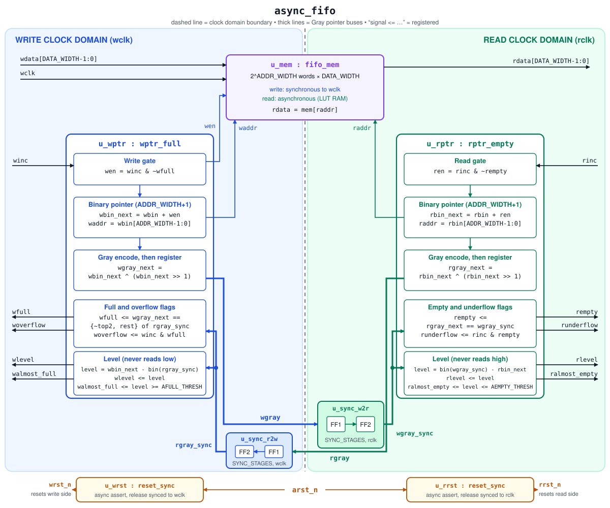
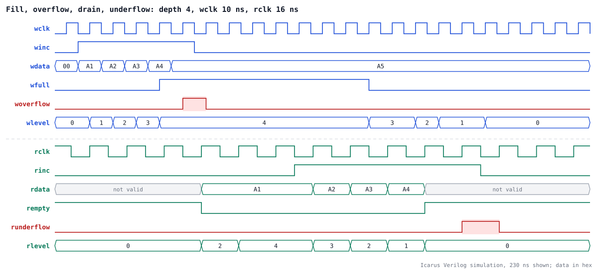

# Asynchronous FIFO for Clock Domain Crossing

[](https://github.com/Prathik28/async-fifo-cdc/actions/workflows/lint.yml) [](https://github.com/Prathik28/async-fifo-cdc/actions/workflows/synth.yml) [](https://github.com/Prathik28/async-fifo-cdc/actions/workflows/sim.yml) [](https://github.com/Prathik28/async-fifo-cdc/actions/workflows/mutation.yml) [](https://github.com/Prathik28/async-fifo-cdc/actions/workflows/formal.yml)

A parameterized dual-clock FIFO in SystemVerilog, using Gray-code pointers and
multi-flop synchronizers. It is checked by lint, synthesis, simulation,
assertions, fault injection and formal proof, all run by GitHub Actions.

## Architecture



Data moves from the write domain to the read domain through `fifo_mem`. The two
Gray-coded pointers cross through synchronizers: `wgray` into the read domain
and `rgray` into the write domain. Each synchronizer is clocked and reset by the
domain receiving the pointer, and has `SYNC_STAGES` flops (two are drawn, the
default).

A `reset_sync` in each domain turns the single `arst_n` into a reset that
asserts asynchronously and releases synchronously.

## Features

* Parameterized data width, depth (power of two, at least 4) and synchronizer
  depth (at least 2)
* First-word fall-through read
* `full` and `empty`, plus `almost_full` and `almost_empty` with set thresholds
* Fill level in each domain: `wlevel` never reads low, `rlevel` never reads high
* One-cycle `woverflow` and `runderflow` pulses; refused transfers change nothing
* One asynchronous reset input, synchronized into both domains

## Parameters

| Parameter       | Default     | Meaning                                   |
|-----------------|-------------|-------------------------------------------|
| `DATA_WIDTH`    | 8           | Word width in bits                        |
| `ADDR_WIDTH`    | 4           | Depth is `2**ADDR_WIDTH`; minimum 2       |
| `SYNC_STAGES`   | 2           | Flops in each synchronizer; minimum 2     |
| `AFULL_THRESH`  | depth - 2   | `walmost_full` when `wlevel` >= this      |
| `AEMPTY_THRESH` | 2           | `ralmost_empty` when `rlevel` <= this     |

## Ports

| Domain | Inputs          | Outputs                                                   |
|--------|-----------------|-----------------------------------------------------------|
| async  | `arst_n`        |                                                           |
| write  | `wclk`, `winc`, `wdata` | `wfull`, `walmost_full`, `wlevel`, `woverflow`    |
| read   | `rclk`, `rinc`  | `rdata`, `rempty`, `ralmost_empty`, `rlevel`, `runderflow` |

A word is written on a `wclk` edge where `winc && !wfull`. `rdata` is valid while
`rempty` is low, and is consumed on an `rclk` edge where `rinc && !rempty`.
Hold `arst_n` low for at least one period of the slower clock, with both clocks
running when it is released.

## Waveform



A 4-deep FIFO with a 10 ns write clock and a 16 ns read clock:

* Four writes fill it and `wfull` rises. The fifth word, `A5`, is refused and
  `woverflow` pulses.
* `rempty` falls only after the write pointer has crossed into the read domain.
  `rlevel` can lag the true count during this time.
* Words `A1` to `A4` come out in order. A fifth read request is refused and
  `runderflow` pulses.
* `wfull` falls only after the read pointer has crossed back.

The image is drawn from an Icarus Verilog run of
[`tb/tb_waveform.sv`](tb/tb_waveform.sv), which checks the data order and pulse
counts. Regenerate it with `./scripts/waveform.sh` (needs Icarus Verilog and
Python 3). CI does not regenerate it.

## Verification

| Check | What it covers |
|-------|----------------|
| Lint | `verilator --lint-only -Wall` on four parameter sets, with one documented waiver in `reset_sync` |
| Synthesis | Yosys generic and Xilinx 7-series flows; fails on any inferred latch |
| Simulation | 36 runs: 3 parameter sets x 6 clock ratios x 2 seeds, on Verilator and again on Icarus Verilog |
| Assertions | Overflow, underflow, Gray/binary pointer coherency, one-bit Gray changes, level range (Verilator runs) |
| Fault injection | 9 planted bugs, each of which the testbench must catch |
| Formal | Unbounded safety proof and reachability covers with SymbiYosys |

**Clock ratios** (write:read period in ns): 10:10 with a phase offset, 10:23,
23:10, 10:80, 80:10 and 10:10.1, where the phase drifts through many offsets.

**Testbench.** A reference queue checks data and ordering, both level
guarantees and the error pulses. It covers repeated fill and drain, four traffic
mixes and a reset during traffic, and fails if full, empty, overflow, underflow
or pointer wraparound is never reached.

**Formal.** The harness uses only the FIFO's ports and its own transfer counters.
Both clocks are unconstrained, so no frequency or phase relationship is assumed.
It proves that occupancy stays within the depth, that no write is accepted when
full and no read when empty, that both level guarantees hold, and that data
comes out unchanged and in order. Scope: `DATA_WIDTH=2`, `ADDR_WIDTH=2`,
`SYNC_STAGES=2`, with reset applied at the start only. Wider and deeper
configurations, and reset during traffic, are covered by simulation alone.

## Running it

Needs Verilator 5, Icarus Verilog, Yosys and, for `formal`, SymbiYosys with z3.
The [OSS CAD Suite](https://github.com/YosysHQ/oss-cad-suite-build) has all of
them and is what CI uses.

```bash
make all
```

Single steps are `make lint`, `synth`, `sim`, `sim-icarus`, `mutation` and
`formal`. Verilator cannot build in a path that contains spaces; set
`BUILD_DIR` to a directory without them.

## Synthesis estimate

Yosys `synth_xilinx` for the default 16 x 8 configuration reports 58 flip-flops
and 2 `RAM32M` LUT RAM primitives, with no latches. These are Yosys figures, not
Vivado utilization, and say nothing about timing.

## Limitations

* **Vivado is not part of CI.** The constraints in
  [`constraints/async_fifo.xdc`](constraints/async_fifo.xdc) have not been
  validated in a Vivado run, and nothing here has been tested on hardware.
* Simulation and formal proof treat flip-flops as ideal. They do not model
  metastability or bit-to-bit routing skew. Protection against those comes from
  the Gray coding, the synchronizers and correct timing constraints.
* The memory uses an asynchronous read (LUT RAM). There is no block RAM variant.

## Layout

```
rtl/          design sources (files.f lists them)
tb/           self-checking testbench and the waveform testbench
sva/          assertions, attached with bind
formal/       SymbiYosys harness and configuration
scripts/      CI check scripts and waveform generation
constraints/  Xilinx timing constraints
vivado/       Vivado script for the ZedBoard part (not yet run in Vivado)
docs/         design notes, architecture diagram and waveform
.github/      GitHub Actions workflows, one per check
```

See [docs/design.md](docs/design.md) for the reasoning behind the design.

## License

[MIT](LICENSE)
